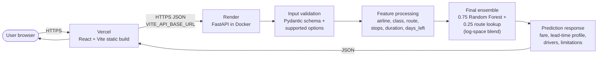

<div align="center">

# AirfareIndex

**Intelligent Airfare Prediction System**

A supervised machine learning application that estimates Indian domestic airfares from historical listed fares, served through a FastAPI backend and a React interface.

[](https://airfare-index-puce.vercel.app)
[](https://airfareindex-api.onrender.com/health)
[](backend/requirements.txt)
[](backend/requirements.txt)
[](backend/requirements.txt)
[](frontend/package.json)
[](frontend/package.json)

[Live application](https://airfare-index-puce.vercel.app) · [Prediction page](https://airfare-index-puce.vercel.app/predict) · [Methodology](https://airfare-index-puce.vercel.app/methodology) · [GitHub repository](https://github.com/Ashwell-CG/AirfareIndex)

</div>

> **Important:** AirfareIndex estimates airfares from historical listed fares. It does not show live prices and does not guarantee that any airline will sell a seat at the estimated price.

## Contents

1. [Live demo](#live-demo)
2. [Overview](#overview)
3. [Key features](#key-features)
4. [Screenshots](#screenshots)
5. [System architecture](#system-architecture)
6. [Machine learning methodology](#machine-learning-methodology)
7. [Dataset](#dataset)
8. [Model performance](#model-performance)
9. [Real-world validation status](#real-world-validation-status)
10. [Technology stack](#technology-stack)
11. [Project structure](#project-structure)
12. [API documentation](#api-documentation)
13. [Local installation](#local-installation)
14. [Testing](#testing)
15. [Deployment](#deployment)
16. [Limitations](#limitations)
17. [Future improvements](#future-improvements)
18. [Academic documentation](#academic-documentation)
19. [Author](#author)

## Live demo

| Resource | URL |
|---|---|
| Web application | https://airfare-index-puce.vercel.app |
| Prediction page | https://airfare-index-puce.vercel.app/predict |
| Backend health check | https://airfareindex-api.onrender.com/health |
| Backend readiness (model loaded) | https://airfareindex-api.onrender.com/ready |
| Supported options | https://airfareindex-api.onrender.com/options |

The backend runs on a free hosting plan. After a period of inactivity the first request can take 30 to 60 seconds while the service wakes up and loads the model.

Interactive API documentation (`/docs`, `/redoc`, `/openapi.json`) is **disabled in production** by design. The endpoints are documented in [API documentation](#api-documentation) below.

## Overview

Airfares change with route, airline, cabin, stops, duration and how far ahead a flight is booked. Prices also depend on demand, seat inventory and competitor pricing, which are not visible in a fare table. Because of this, a useful estimate has to be built from historical examples and be clear about its limits.

AirfareIndex takes an itinerary and returns an estimated fare in Indian rupees (INR):

1. The user chooses a route, airline, cabin, stops, duration and booking lead time on the prediction page.
2. The frontend only offers combinations that exist in the model's training data.
3. The backend validates the request against the same supported options and rejects anything outside them.
4. A saved ensemble model returns the estimate, plus a lead-time profile, the main factors behind it and the model's known limitations.

The project is built as an academic machine learning study and as a deployable application. It does not scrape or query live airline prices.

## Key features

- **Supervised regression** of airfare (INR) on itinerary features, trained on historical listed fares.
- **Guided input**: the interface shows only airlines, classes and routes the model supports.
- **Prediction API** (`POST /predict`) with strict input validation and a consistent error format.
- **Lead-time profile**: the estimate across booking lead times from 1 to 50 days.
- **Explanations**: the main factors behind each estimate, and the model's typical error on unseen flights, labelled as model-level and not per-prediction confidence.
- **Model information and insights** endpoints for the methodology page.
- **Interactive React interface** with a 3D hero scene that falls back to a static view on devices without WebGL.
- **Production deployment** on Vercel (frontend) and Render (backend), with CORS limited to the frontend origin.
- **Real-world validation pipeline** for comparing predictions with manually verified fares (see [Real-world validation status](#real-world-validation-status)).

## Screenshots

No screenshots are committed to this repository yet. The screenshot folder `docs/screenshots/` is listed in `.gitignore`, so the images captured during development are kept locally and do not appear on GitHub.

To add screenshots later: capture them from the live application, save them under `docs/images/`, and reference them here with relative paths, for example ``.

## System architecture



Component summary:

| Component | Where it runs | Role |
|---|---|---|
| React + Vite frontend | Vercel (static files) | Prediction form, results, methodology page, 3D hero |
| FastAPI backend | Render (Docker, one uvicorn worker) | Validates requests, loads the model once, returns predictions |
| Saved model | Inside the backend image | `backend/saved_models/final/airfare_model.joblib` (about 27 MB) |
| Supported options | Inside the backend image | `backend/data/processed/supported_options.json` |

In local development, Vite proxies `/api/*` to the backend on `127.0.0.1:8000`. In production, the frontend calls the Render URL directly and the backend allows only the exact Vercel origin.

## Machine learning methodology

### Problem

Supervised regression. For each itinerary the target is the listed fare in INR. Inputs are airline, travel class, source and destination city, stops, duration in hours, days between booking and departure (`days_left`, 1 to 50), and departure time in minutes. The departure-time input is accepted by the API but is **not used** by the final model.

### Pipeline

1. **Data preparation**: raw files are read, duplicates and invalid rows are checked, and the supported city, airline and class combinations are recorded (`backend/ml/preprocessing.py`, `backend/ml/eda.py`).
2. **Splitting**: train, validation and test sets are built by blocks of journey dates and by held-out flights, so that evaluation is not only on rows the model has seen (`backend/ml/splits.py`).
3. **Feature engineering**: categorical encoding for airline, class, route and stops; numeric duration and lead time (`backend/ml/feature_engineering.py`, `backend/ml/models.py`).
4. **Experimentation**: linear, tree and boosting models were compared on the same splits (`backend/ml/train.py`, `backend/ml/evaluation.py`).
5. **Hyperparameter tuning**: the Random Forest was tuned on development data only (`backend/ml/p6_tune.py`).
6. **Final selection**: candidates were ranked on unseen-flight error, stability across random seeds, an external shift check and practical costs (`backend/ml/p6_select.py`, [`docs/06-final-model-selection.md`](docs/06-final-model-selection.md)).
7. **Final fit and verification**: the selected configuration was retrained on the training data and checked for reproducibility (`backend/ml/p6_train.py`, `backend/ml/p6_verify.py`).

### Final model

The final model is a **log-space blend** of two members:

- **Random Forest (weight 0.75)**: 150 trees, `min_samples_leaf` 20, `max_depth` 32, `max_features` 0.2, `max_samples` 0.5, trained on `log1p(fare)`.
- **Route lookup (weight 0.25)**: the training median fare for airline, route, class and stops, with fallbacks to coarser groups.

For an itinerary `x`, with member predictions `f_RF(x)` and `f_lookup(x)` in INR:

$$
\hat{y}(x) = \exp\!\Big(0.75 \cdot \log(1 + f_{RF}(x)) + 0.25 \cdot \log(1 + f_{lookup}(x))\Big) - 1
$$

Blending in log space keeps the combined estimate positive and reduces the influence of very large fares. The implementation is `LogBlend` in `backend/ml/p6_common.py`.

## Dataset

| Dataset | Use in this project | Coverage |
|---|---|---|
| **E** (`yashdharme36/airfare-ml-predicting-flight-fares` on Kaggle, CC0) | Training and development | Journeys 16 Jan to 6 Mar 2023; seven metro cities (Ahmedabad, Bangalore, Chennai, Delhi, Hyderabad, Kolkata, Mumbai); one booking platform |
| **A** (`shubhambathwal/flight-price-prediction` on Kaggle, CC0) | External temporal shift check only | Journeys 11 Feb to 31 Mar 2022; the same platform, different period |

Details, sources and cleaning checks are in [`docs/02-dataset-research.md`](docs/02-dataset-research.md) and [`docs/03-eda-report.md`](docs/03-eda-report.md).

Key facts and limitations of the training data:

- **Time coverage**: about seven weeks of journey dates (January to early March 2023), so seasonal effects are not represented.
- **Single snapshot**: all rows come from one booking date (15 Jan 2023). As a result, `days_left` is equal to the journey date minus that date, so lead time and calendar effects cannot be separated.
- **Listed fares**: the data records fares shown by one platform, not fares that were booked.
- **Tax basis**: the training fares are not documented as tax-inclusive or tax-exclusive. The API cannot confirm this.
- **Supported domain**: 7 cities, 9 airlines, 3 classes (Economy, Premium Economy, Business). First Class is not supported. `days_left` must be between 1 and 50.

The raw datasets are not included in this repository (they are git-ignored). The backend needs only the committed `supported_options.json`, which lists the supported combinations.

## Model performance

These are **historical held-out results** from the Phase 6 evaluation on flights the model had not seen in training. They describe the test setup only and are **not a measure of real-world accuracy** (see [Real-world validation status](#real-world-validation-status)).

| Metric (unseen flights, 10 random seeds) | Historical result |
|---|---:|
| MAE | ₹3,154 ± 185 |
| R² | 0.918 ± 0.006 |
| Median absolute percentage error (MdAPE) | 11.4% ± 0.7 |

Source: [`docs/06-robust-evaluation.md`](docs/06-robust-evaluation.md) and [`backend/saved_models/final/final_model_metadata.json`](backend/saved_models/final/final_model_metadata.json).

How to read these:

- **MAE** (mean absolute error) is the average size of the error in rupees, ignoring its sign.
- **R²** is the share of variation in fares explained by the model, compared with always predicting the average. Values near 1 are better. Pooled R² is high partly because fares differ a lot between classes; within-class results are weaker (see [`docs/05-model-development-report.md`](docs/05-model-development-report.md)).
- **MdAPE** (median absolute percentage error) is the typical error as a percentage of the true fare. It is the median, so a few large misses do not dominate it.

Results on flights the model had seen on other dates are better (MAE ₹2,849, MdAPE 9.9%), as documented in [`docs/06-generalisation-study.md`](docs/06-generalisation-study.md). Accuracy on a dataset from another period (Dataset A) is much lower, which is why the model is only valid for the period it was trained on.

## Real-world validation status

Phase 10 added a pipeline that compares model predictions with manually verified fares from public booking sites. The pipeline exists; the evidence it needs does not yet.

| Item | Status |
|---|---|
| Validation pipeline (`backend/scripts/real_world_validation.py`) | Implemented and tested |
| Verified real-world fare observations | **0** |
| Valid real-world comparisons | **0** |
| Real-world accuracy metrics | **Not yet available** |
| Production connectivity (backend endpoints, CORS, prediction) | Verified |
| Production browser verification (`frontend/e2e/verify-deployment.mjs`) | 40 of 40 checks passed |
| Backend tests | 102 passed |
| Frontend tests | 60 passed |

The historical held-out results above must not be read as real-world accuracy. Real-world accuracy will be reported only when verified observations exist.

Collection is manual. Automated scraping is not used: airline and booking sites restrict automated access. The procedure, the matching checklist and an example row are in [`reports/real_world_validation/README.md`](reports/real_world_validation/README.md). The folder `reports/` is not committed yet.

## Technology stack

| Area | Technologies |
|---|---|
| Frontend | React 19, Vite 8, React Router 7, Tailwind CSS 4, Framer Motion, three.js with React Three Fiber, Lucide icons |
| Backend | Python 3.14, FastAPI 0.165, Uvicorn 0.54, Pydantic 2 |
| Machine learning | scikit-learn 1.9.1 (Random Forest), XGBoost 3.4.1 (candidate models), NumPy 2.5, pandas 3.1, joblib, SHAP (explainability analysis) |
| Data processing | pandas, NumPy, openpyxl |
| Deployment | Vercel (static frontend), Render (Docker web service), Docker (`python:3.14-slim` base image) |
| Testing | pytest (backend), Vitest and Testing Library (frontend), puppeteer-core (browser checks), oxlint (linting) |

## Project structure

```text
AirfareIndex/
├── backend/
│   ├── app/                     FastAPI application
│   │   ├── main.py              app factory, CORS, production mode, middleware
│   │   ├── routes/api.py        HTTP endpoints
│   │   ├── schemas/prediction.py  request and response models
│   │   ├── services/predictor.py  loads the model once; prediction service
│   │   ├── errors.py            consistent JSON error responses
│   │   └── resources/           static JSON used by insights and hints
│   ├── ml/                      training, evaluation and inference code
│   │   ├── inference.py         model loading and input validation
│   │   ├── p6_common.py         LogBlend and RouteLookup definitions
│   │   └── p6_*.py              Phase 6 tuning, selection and verification
│   ├── saved_models/final/      selected model and metadata (committed)
│   ├── data/processed/supported_options.json  supported combinations (committed)
│   ├── scripts/                 resource builder; real-world validation script
│   ├── tests/                   backend test suite
│   ├── Dockerfile               production image
│   ├── requirements.txt         full development environment
│   └── requirements-prod.txt    minimal runtime dependencies
├── frontend/
│   ├── src/pages/               landing, prediction and methodology pages
│   ├── src/components/          form, result panel, UI and motion components
│   ├── src/three/               3D hero scene (lazy-loaded)
│   ├── src/services/api.js      API client (uses VITE_API_BASE_URL)
│   ├── e2e/                     browser checks, including verify-deployment.mjs
│   ├── vercel.json              Vercel build and SPA routing
│   └── vite.config.js           dev and preview proxy to the backend
├── docs/                        phase reports, metrics and figures
├── reports/real_world_validation/  validation inputs and outputs
├── render.yaml                  Render blueprint for the backend
├── start-dev.ps1                starts backend and frontend for local work
└── README.md
```

Key documents:

| File | Contents |
|---|---|
| [`docs/01-architecture.md`](docs/01-architecture.md) | Project architecture and decisions |
| [`docs/02-dataset-research.md`](docs/02-dataset-research.md) | Dataset sources, audit and selection |
| [`docs/03-eda-report.md`](docs/03-eda-report.md) | Exploratory data analysis |
| [`docs/04-feature-engineering-report.md`](docs/04-feature-engineering-report.md) | Splits and features |
| [`docs/05-model-development-report.md`](docs/05-model-development-report.md) | Model comparison |
| [`docs/06-final-model-selection.md`](docs/06-final-model-selection.md) | Final model choice |
| [`docs/06-robust-evaluation.md`](docs/06-robust-evaluation.md) | Multi-seed unseen-flight results |
| [`docs/06-external-validation.md`](docs/06-external-validation.md) | Dataset A shift check |
| [`docs/06-model-explainability.md`](docs/06-model-explainability.md) | Explainability analysis |
| [`docs/07-production-integration-report.md`](docs/07-production-integration-report.md) | Backend integration |
| [`docs/08-frontend-transformation-report.md`](docs/08-frontend-transformation-report.md) | Frontend design and testing |
| [`docs/09-production-deployment-report.md`](docs/09-production-deployment-report.md) | Deployment configuration and checks |

## API documentation

Base URL in production: `https://airfareindex-api.onrender.com`. Locally: `http://127.0.0.1:8000`. All endpoints return JSON.

| Method | Path | Purpose |
|---|---|---|
| GET | `/health` | Liveness: returns `{"status":"ok"}` without touching the model |
| GET | `/ready` | Readiness: `{"status":"ready","model":"blend_rf_lookup"}` once the model is loaded; 503 otherwise |
| GET | `/options` | Supported cities, airlines, classes, stops, lead-time range and duration hints |
| GET | `/model/info` | Model name, description, training period and evaluation summary |
| GET | `/model/insights` | Model insights used by the methodology page |
| POST | `/predict` | Estimated fare for one itinerary |

### POST /predict request

| Field | Type | Rule |
|---|---|---|
| `source` | string | Supported origin city, for example `Delhi` |
| `destination` | string | Supported destination city; must differ from `source` |
| `airline` | string | Supported airline for that route and class |
| `travel_class` | string | `Economy`, `Premium Economy` or `Business` |
| `departure_time` | string | 24-hour `HH:MM`; accepted, not used by the model |
| `stops` | string | `non-stop`, `1-stop` or `2+-stop` |
| `duration_hours` | number | Greater than 0 and at most 60 |
| `days_left` | integer | 1 to 50 |

Unknown fields are rejected.

Example request:

```json
{
  "source": "Delhi",
  "destination": "Mumbai",
  "airline": "Vistara",
  "travel_class": "Economy",
  "departure_time": "09:30",
  "stops": "non-stop",
  "duration_hours": 2.25,
  "days_left": 14
}
```

Example response (abbreviated; the full response also includes `lead_time_profile`, `drivers` and `limitations`):

```json
{
  "predicted_fare_inr": 7220,
  "currency": "INR",
  "departure_time_used_by_model": false,
  "typical_error": {
    "metric": "median absolute percentage error",
    "value_pct": 11.4,
    "is_per_prediction_confidence": false
  },
  "model": {
    "name": "blend_rf_lookup"
  }
}
```

Error responses use one shape:

```json
{
  "error": "validation_error",
  "message": "Some inputs are missing or invalid.",
  "fields": [{"field": "days_left", "message": "Input should be less than or equal to 50"}]
}
```

Other error codes include `unsupported_itinerary` (422), `model_unavailable` (503) and `prediction_failed` (500).

## Local installation

These steps are for Windows PowerShell. You need Python 3.14 and Node.js (tested with 24.18.0).

**1. Clone the repository**

```powershell
git clone https://github.com/Ashwell-CG/AirfareIndex.git
cd AirfareIndex
```

**2. Create and activate a virtual environment, then install the backend requirements**

```powershell
python -m venv backend\.venv
backend\.venv\Scripts\python -m pip install -r backend\requirements.txt
```

The full requirements include the training and analysis libraries. To run only the API, `backend\requirements-prod.txt` is sufficient.

**3. Start the backend**

```powershell
cd backend
.\.venv\Scripts\python -m uvicorn app.main:app --port 8000
```

Check it in a second PowerShell window: `http://127.0.0.1:8000/ready` should return `"status":"ready"`. Interactive docs are available locally at `http://127.0.0.1:8000/docs`.

**4. Install the frontend dependencies**

```powershell
cd ..\frontend
npm install
```

**5. Configure the frontend API address (optional locally)**

Leave `VITE_API_BASE_URL` unset for local development. The dev server then sends `/api` requests to the backend through its proxy. To point at the production backend instead, copy `frontend\.env.example` to `frontend\.env.local` and set:

```text
VITE_API_BASE_URL=https://airfareindex-api.onrender.com
```

**6. Start the frontend**

```powershell
npm run dev
```

Open `http://localhost:5173`. Use `localhost`, not `127.0.0.1`.

To start both servers with one command from the project root, run `.\start-dev.ps1`.

## Testing

Verified in this repository:

| Suite | Command (from the folder shown) | Result |
|---|---|---|
| Backend | `python -m pytest` (in `backend`, with the venv Python) | 102 passed |
| Validation logic | `python -m pytest tests\test_real_world_validation.py` (in `backend`) | Included in the backend total |
| Frontend | `npm run test:run` (in `frontend`) | 60 passed |
| Production browser checks | `node e2e/verify-deployment.mjs https://airfare-index-puce.vercel.app https://airfareindex-api.onrender.com --browser` (in `frontend`) | 40 of 40 passed |

Other checks available in `frontend`:

```powershell
npm run lint                     # oxlint
npm run build                    # production build to dist\
node e2e/crossbrowser.mjs        # requires installed Chrome, Edge or Firefox against a running app
```

The backend test files are in `backend/tests/`. The validation tests use stubbed API responses; they do not contact the deployed service.

## Deployment

### Backend on Render

- Blueprint: [`render.yaml`](render.yaml). Service type: Docker, built from `backend/Dockerfile`.
- Health check: `/ready`, which returns 200 only after the model is loaded.
- Environment variables:

| Name | Value |
|---|---|
| `AIRFARE_ENV` | `production` (disables API docs; requires an explicit CORS list) |
| `AIRFARE_CORS_ORIGINS` | The exact frontend origin, with no trailing slash and no wildcard |
| `AIRFARE_LOG_LEVEL` | Optional. Defaults to `INFO` |
| `PORT` | Set by the hosting platform |

### Frontend on Vercel

- Project root directory: `frontend`. Framework preset: Vite. Build command: `npm run build`. Output directory: `dist`.
- Environment variable: `VITE_API_BASE_URL` set to the Render backend URL, with no trailing slash and no `/api` suffix. It is read at build time, so redeploy after changing it.
- Routing: [`frontend/vercel.json`](frontend/vercel.json) rewrites all paths to `index.html`, so direct links and refreshes work.

### CORS

The backend allows only the origin listed in `AIRFARE_CORS_ORIGINS`, for `GET`, `POST` and `OPTIONS`, with no credentials. In production the app refuses to start if the list is empty or contains `*`. If the frontend shows "couldn't reach the prediction service", check that this value matches the Vercel origin exactly.

No secrets are required. The project does not store API keys or credentials.

## Limitations

- **Historical data**: training covers one booking platform, one booking snapshot and about seven weeks of journeys in early 2023.
- **Temporal shift**: the model was not recalibrated for other periods. The 2022 check shows much larger errors.
- **Limited coverage**: seven cities, nine airlines and three classes. First Class is not supported, and unlisted cities or routes are rejected.
- **Dynamic pricing**: airline pricing responds to demand, inventory, competitor fares and events that the model cannot see.
- **Lead time confounding**: `days_left` cannot be separated from calendar effects in the training data.
- **Tax basis unknown**: the training fares are not documented as tax-inclusive or exclusive.
- **Departure time unused**: the field is accepted but has no effect on the estimate.
- **Real-world accuracy not established**: there are no verified real-world comparisons yet.
- **Free hosting**: the backend can sleep when idle and has no rate limiting beyond a concurrency cap and a 16 KB request limit.

## Future improvements

These are proposals, not features of the current version.

- Use a more recent airfare dataset and retrain under a documented protocol.
- Expand the supported cities, routes and airlines, with the data to support them.
- Add a temporal evaluation that trains on earlier periods and tests on later ones.
- Collect and report verified real-world comparisons using the existing validation pipeline.
- Monitor prediction error over time once real observations are available.
- Document the tax basis of the training fares, or add a tax-aware target.
- Improve explanations, for example per-prediction uncertainty, once it can be validated.

## Academic documentation

Links below point to files in this repository.

| Document | Link |
|---|---|
| Architecture | [`docs/01-architecture.md`](docs/01-architecture.md) |
| Dataset research and audit | [`docs/02-dataset-research.md`](docs/02-dataset-research.md) |
| Exploratory data analysis | [`docs/03-eda-report.md`](docs/03-eda-report.md) |
| Feature engineering | [`docs/04-feature-engineering-report.md`](docs/04-feature-engineering-report.md) |
| Model development | [`docs/05-model-development-report.md`](docs/05-model-development-report.md) |
| Phase 6 final report | [`docs/06-phase6-final-report.md`](docs/06-phase6-final-report.md) |
| Final model selection | [`docs/06-final-model-selection.md`](docs/06-final-model-selection.md) |
| Real-world validation procedure | [`reports/real_world_validation/README.md`](reports/real_world_validation/README.md) |
| Deployment report | [`docs/09-production-deployment-report.md`](docs/09-production-deployment-report.md) |

A PowerPoint presentation and an IEEE research paper are not yet in this repository.

## Author

| Field | Details |
|---|---|
| Student name | [Student name] |
| University | [University name] |
| Department | [Department] |
| Programme and semester | [Programme], [Semester] |
| Project supervisor | [Supervisor name] |
| Academic year | [Year] |

Contact and GitHub profile: [add if you wish to share them].
