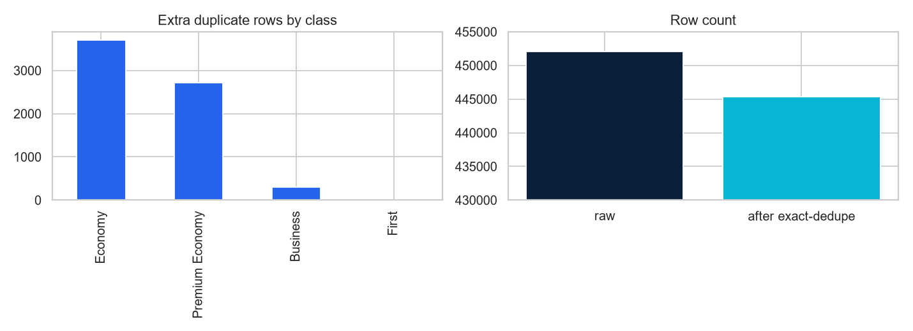
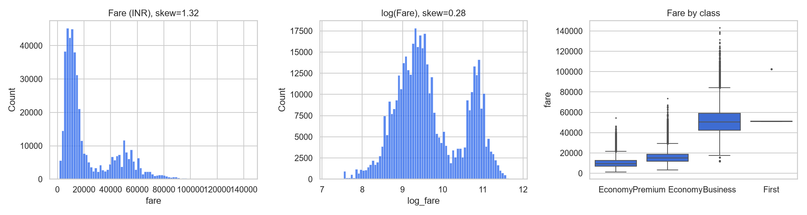
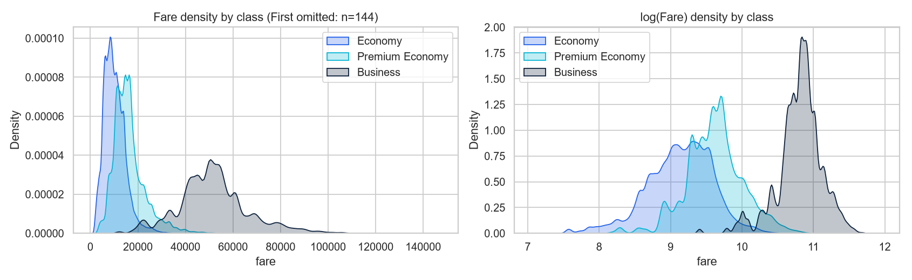
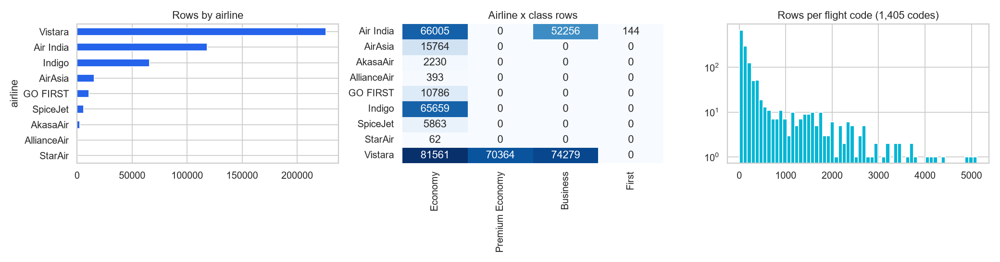
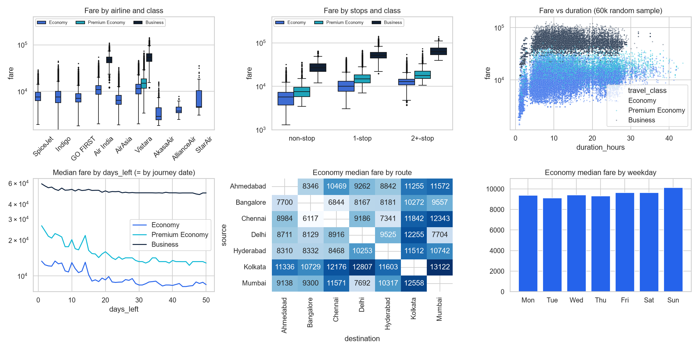
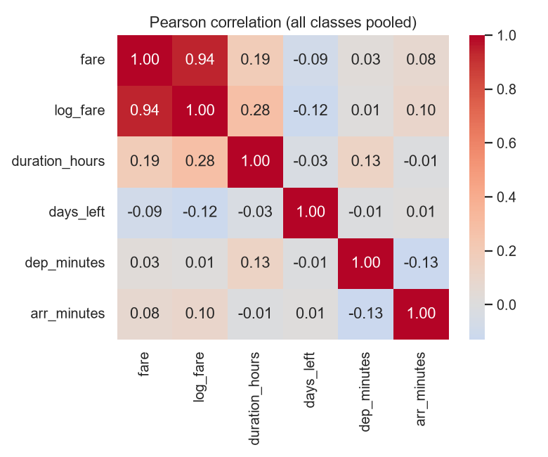
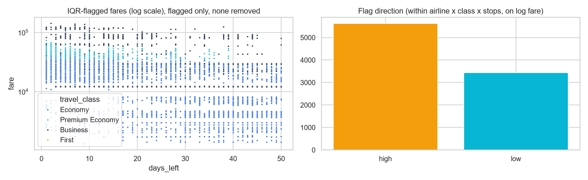
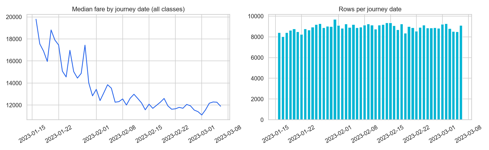

# Phase 3: Data Preprocessing and EDA (Dataset E, Airfare ML)

Every number here is produced by `backend/ml/eda.py` and `backend/ml/preprocessing.py` and stored in `docs/03-eda-stats.json`. Reproduce (from `backend/`):

```powershell
.\.venv\Scripts\python -X utf8 -m ml.preprocessing   # writes data/processed/airfare_e_clean.csv, prints the cleaning log
.\.venv\Scripts\python -X utf8 -m ml.eda             # writes docs/figures/*.png and docs/03-eda-stats.json
```

No model was trained and Dataset A was not touched. The raw files in `backend/data/raw/E_yashdharme/` were only read; their SHA-256 values (`SHA256SUMS.txt`) were re-checked after every run and match. Figures are static matplotlib images for the report; interactive Plotly charts come with the app.

## 1. Data quality summary

| Check | Result |
|---|---|
| Raw size | 452,088 rows; `Cleaned_dataset.csv` 13 columns, `Scraped_dataset.csv` 8 columns |
| Row alignment of the two files | Price, date, source, destination, flight code and class agree in 100% of rows, so the exact clock times in the scraped file can be attached to the cleaned file |
| Missing values | 0 in both files |
| Exact duplicate rows | 6,722 extra copies (1.49%); 12,001 rows belong to a duplicate group (group sizes 2 to 7: 4,089 / 977 / 177 / 33 / 2 / 1) |
| Invalid values | None: no fare <= 0, no duration <= 0, weekday matches the date in all rows, duration matches (arrival - departure) in all rows, departure/arrival buckets match the exact clock times in all rows |
| Dtypes | `Cleaned_dataset.csv`: 3 numeric (duration, days_left, fare) and 10 text columns; the scraped file is all text (prices contain commas, times and cities share one string) |
| After cleaning | 445,366 rows, 0 nulls |



**Duplicates.** The copies are identical in every column, including exact departure/arrival time and fare (checked on the scraped file, which is finer-grained). Duplication is not uniform: 3.71% of Premium Economy rows, 1.47% of Economy and 0.24% of Business are extra copies. I cannot tell whether the scraper listed the same offer twice or whether they are repeated listings, so I treat them as one observation. Removing them moves the mean fare from 22,840.1 to 22,919.7 and the median from 13,407 to 13,362, so the effect on the target is small. The main reason to remove them is that copies could land on both sides of a train/test split.

## 2. Target: fare (INR)

After de-duplication (n = 445,366): min 1,307; median 13,362; mean 22,919.7; std 20,394; max 143,019. Quantiles: 1% 2,857; 5% 4,992; 25% 8,712; 75% 36,980; 95% 62,560; 99% 83,325; 99.9% 104,706.

| Class | n | min | median | max | skew | skew of log(fare) |
|---|---|---|---|---|---|---|
| Economy | 248,323 | 1,307 | 9,494 | 54,600 | 1.18 | -0.44 |
| Premium Economy | 70,364 | 3,439 | 14,956 | 73,550 | 1.53 | -0.11 |
| Business | 126,535 | 12,000 | 50,409 | 143,019 | 0.57 | -0.78 |
| First | 144 | 50,855 | 51,268 | 102,321 | 1.62 | 1.62 |




Pooled fare is right-skewed (skew 1.32). Taking the log reduces skew to 0.28 but the histogram becomes **bimodal**, because it is a mixture of an economy-type group and a business-type group, not a single skewed population. Within a class the log is not clearly better (Business and Economy become left-skewed). So a log target is a candidate to test in Phase 5, not a settled choice.

## 3. Features

Cardinality: airline 9, flight_code 1,405, class 4, source 7, destination 7, stops 3, departure bucket 4, arrival bucket 4.



**Class is tied to airline.** Premium Economy appears only for Vistara (70,364 rows). Business appears only for Air India (52,256) and Vistara (74,279). First appears only for Air India (144 rows, 4 routes, 4 distinct fares). Low-cost carriers (Indigo, AirAsia, SpiceJet, GO FIRST, Akasa, Alliance Air, Star Air) are Economy only. The app's prediction form must only allow airline/class combinations that exist in the data.

**Flight code.** 1,405 codes; median 93 rows per code, max 5,117; 448 codes have fewer than 50 rows. Every code belongs to exactly one airline, so the code carries the airline plus a flight identity.

## 4. Relationships with fare




Share of variance in log(fare) explained by a single feature's group means (a descriptive in-sample statistic, not a model):

| Feature | All classes pooled | Economy only |
|---|---|---|
| travel class | 0.755 | n/a |
| flight_code (1,405 levels) | 0.362 | not computed |
| airline | 0.274 | 0.235 |
| stops | 0.109 | 0.272 |
| route (source-destination) | 0.019 | 0.111 |
| days_left (as category) | 0.019 | 0.103 |
| departure bucket | 0.011 | 0.014 |
| weekday | 0.000 | 0.003 |

- **Class dominates**, and much of the "airline" effect is class mix. Within Economy, stops (0.272) and airline (0.235) matter most.
- **Stops:** Economy median fare is 5,737 non-stop, 10,075 for 1 stop and 12,925 for 2+ stops. Durations: non-stop mean 2.11 h; 1-stop 13.22 h; 2+ stops 17.32 h.
- **Duration** correlates with fare at r = 0.19 pooled and 0.33 within Economy, 0.18 Business, 0.16 Premium Economy.
- **Days left:** r with fare is -0.31 (Economy), -0.21 (Business), -0.48 (Premium Economy). Median Economy fare falls from 13,298 (1 day) to 8,480 (31-50 days). Business falls from 59,189 to 49,613, Premium Economy from 26,342 to 13,178.
- **Weekday:** small in Economy (median 9,119 on Tuesday to 10,127 on Sunday); the variance share is ~0.
- **Route:** Economy medians run from 6,117 (Chennai to Bangalore) to 13,122 (Kolkata to Mumbai).
- **Time of day:** weak (r with departure minutes about 0.04).

## 5. Outliers (flagged, none removed)

Expensive fares are not errors: top fares are Vistara Business (143,019 for Ahmedabad to Chennai with 1 stop, 2 days before departure), and the cheapest are short non-stop Economy fares (1,307 SpiceJet, Bangalore to Chennai).

I flagged values beyond 1.5 IQR of log(fare) **within airline x class x stops**. My first attempt grouped only by airline x class and flagged 15,136 rows (3.4%), mostly non-stop flights, which showed the grouping mixed two fare regimes; adding stops cut it to **9,065 rows (2.04%)**: 5,620 high, 3,445 low. 1,168 of the high flags are within 2 days of departure, which is a plausible last-minute premium. Business fares reach exactly 12,000 in 32 rows (403 rows are at or below 12,500), so this is a low tail rather than a clear hard floor; this corrects my Phase 2 remark about a "floor". 4,924 rows have duration over 30 hours (long layovers), which I also treat as legitimate.



**Decision:** keep every row. I found no evidence that any flagged fare is an error, and removing the extremes would bias the model toward cheaper fares. Use robust and scale-aware metrics in Phase 6 (MAE, RMSE and error by class).

## 6. Repeated observations, leakage and structural issues



1. **`days_left` is a function of the journey date** (single booking date, 15 Jan 2023; true for 100% of rows), and weekday is a function of date. They cannot be separated, and the "lead-time curve" is a cross-section of different journey dates, not one flight's price over time.
2. **Same flights recur.** 5,833 (airline, flight, route, class) series; median 48 rows, max 942. Rows per (flight, route, class, date): 1 row for 123,230 keys, 2 rows for 34,368, 3 for 25,027, up to 8 and beyond. In 99.7% of multi-row keys the arrival time differs, so these are different itineraries (connections) under the same first-leg flight code, not repeats.
3. **Flight code is an identifier.** It determines the airline, has 1,405 levels, and as a one-hot feature would let a model memorise series. It must not be a plain feature (see strategy).
4. **Redundant fields:** departure/arrival buckets are exact functions of the clock times; weekday is a function of the date; duration is consistent with arrival minus departure.
5. **No target leakage found.** No column is computed from fare.
6. **Chronological preview** (computation only, no model): 50 journey dates, 8,027 to 9,679 rows each. Holding out the last 20% of dates (from 2023-02-25) gives 356,564 train rows with days_left 1-40 and 88,802 test rows with days_left 41-50. Median fare is 13,777 in train and 11,874.5 in test. Only 1 test flight code is absent from train. Because days_left equals date, a chronological split makes the test set a lead-time range never seen in training. Tree models cannot extrapolate, so such a test confounds generalisation with extrapolation.

## 7. Cleaning decisions

| # | Decision | Justification |
|---|---|---|
| 1 | Align the two raw files row by row and attach exact departure/arrival minutes | 100% agreement on six key columns; exact times add information the buckets lose |
| 2 | Drop 6,722 exact duplicate rows | Identical in every field; avoids copies across train/test; small effect on target |
| 3 | Keep all fare outliers | No evidence of errors; low-cost and last-minute fares are legitimate |
| 4 | Fix nothing silently: no imputation needed (0 nulls) | None missing |
| 5 | Flight code whitespace normalised (`G8- 354` becomes `G8-354`) | Cosmetic inconsistency in the raw scraped field |
| 6 | Keep First class rows in the cleaned file but flag them | n = 144, 4 distinct fares, 4 routes, Air India only: too little to learn or evaluate; **decision on exclusion needs your approval** |

## 8. Proposed preprocessing strategy for the supervised pipeline

1. **Order of operations:** de-duplicate, then split, then fit all encoders and scalers inside an sklearn `Pipeline` on training data only.
2. **Split (to be settled with you):** my recommendation is contiguous **date-block holdout** (hold out several blocks of consecutive journey dates spread across the period) so test `days_left` stays within the training range; report the strict chronological holdout as a separate stress test of lead-time extrapolation. Plain random row splits are not acceptable here because of near-twin rows.
3. **Target:** train on fare and on log(fare) and compare; report metrics in INR either way.
4. **Features to carry into Phase 4:** airline, class, source, destination, stops, duration, days_left and time of day. Decide between exact clock times and buckets in Phase 4 (r with fare is small for both).
5. **Flight code:** excluded as a model input; used as a grouping key for diagnostics.
6. **Encoding and scaling:** one-hot for airline, class, source, destination and ordinal for stops; scale numerics only for Linear Regression.
7. **Calendar vs lead time:** choose one representation of the date/lead-time signal and document it, since they are the same information here.
8. **Rare class:** drop or flag First depending on your decision; restrict the app's class/airline options to combinations seen in the data.
9. **External validation:** Dataset A uses a different schema (6 cities, 2 classes, 49 days in 2022) and will be mapped to E's schema in a later phase, using the overlapping routes only.

## 9. Remaining limitations

One booking-date snapshot; Jan to Mar 2023 only; listed (not transacted) fares from one platform; city-level routes among 7 metros; last-minute premium is visible but cannot be separated from date effects; duplicates were removed on an assumption that I cannot verify from the data alone.
